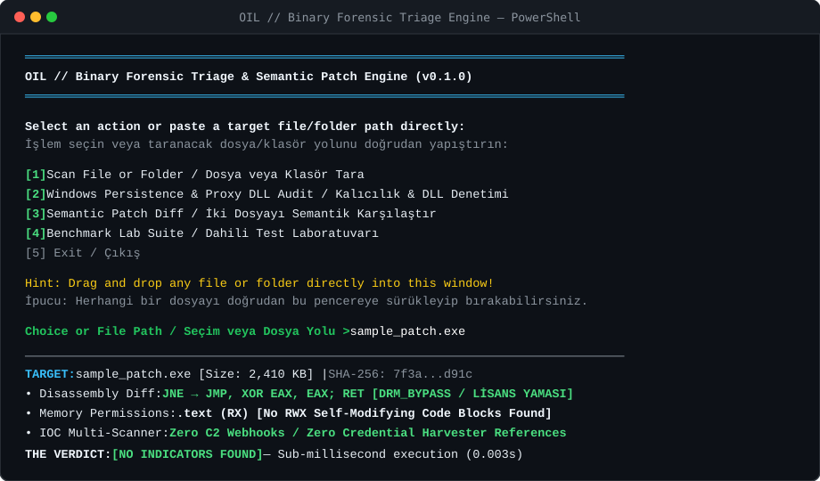

# OIL // Binary Forensic Triage & Semantic Patch Engine

<p align="center">
  <b>High-performance, context-aware binary forensic triage and semantic patch engine written in Rust.</b><br>
  <i>Tersine mühendisler, adli bilişim uzmanları ve güvenlik analistleri için bağımsız, yerel ve saliseler mertebesinde PE triaj motoru.</i>
</p>

<p align="center">
  <a href="#english">English</a> •
  <a href="#türkçe">Türkçe</a>
</p>

<p align="center">
  <a href="https://github.com/erdmsn77/Oil/actions/workflows/release-sign.yml"></a>
  <a href="LICENSE"></a>
  <a href="https://www.rust-lang.org/"></a>
  
</p>

<p align="center">
  
</p>

---

<a name="english"></a>
## English

### Why Oil?
Traditional antivirus engines fail in binary triage: they either blindly flag every modified executable as a generic Trojan, or fail to inspect multi-layer payload stagers and DLL sideloading hooks. Cloud sandbox analyzers, on the other hand, leak proprietary binaries, have minutes of latency, and are easily bypassed by sleep-based evasion techniques.

**Oil solves this in sub-milliseconds with zero cloud dependencies.** Powered by a strict pure-Rust core and instruction-level disassembly (`iced-x86`), Oil dissects untrusted executables, patches, and directories directly on your local machine to decisively separate benign modifications from hostile capabilities.

### Core Differentiators

* **Sub-Millisecond Pure Rust Engine**: 0 cloud calls, 0 external runtime dependencies, 0 telemetry. Complete directory triage in fractions of a second.
* **Semantic Binary Diffing**: Uses machine-code disassembly to mathematically differentiate between benign DRM bypasses (e.g. `JNE` to `JMP`, `XOR EAX, EAX; RET`) and hostile code caves or remote trampoline injections.
* **DLL Hijacking & Sideloading Hunter**: Automatically correlates application directories to catch system DLL shadowing (`version.dll`, `dbghelp.dll`, etc.) and loader suites before execution.
* **Safe In-Memory Archive Inspection**: Inspects ZIP containers completely in-memory with strict zip-bomb guards, byte limits, and uninspected encrypted entry escalation.
* **Epistemic Honesty Guarantee**: Oil strictly rejects dangerous false-clean assumptions. If no indicators are present, it issues `NO INDICATORS FOUND`—never "Clean" or "Safe".
* **Cryptographic Verification**: Verifies Authenticode signatures via native Windows Trust Provider (`WinVerifyTrust` FFI) and distributes release binaries verified with **Sigstore (`cosign`)**.

---

### Key Capabilities

#### 1. PE Deep Autopsy
* **Shannon Entropy Profiling**: Per-section entropy maps pinpointing packers, cryptors, and anomalous sections.
* **RWX Memory Permissions**: Instant detection of self-modifying code, unpacker stubs, and dangerous section flags.
* **Codeless Container Detection**: Flags high-entropy binaries with non-executable or absent code structures.
* **Authenticode Validation**: Root-CA cryptographic trust chain checks.

#### 2. Threat Vector & IOC Extraction
* **Infostealer Vectors**: Detects exfiltration endpoints (Discord Webhooks, Telegram Bot API tokens) across ASCII and UTF-16LE.
* **Credential Harvesters**: Pins hardcoded access paths to Chromium/Gecko databases, Brave, Edge, and crypto wallet stores.
* **Process Injection & Droppers**: Flags memory injection primitives (`VirtualAllocEx`, `WriteProcessMemory`, `CreateRemoteThread`) and obfuscated PowerShell stagers.

#### 3. Semantic Binary Diffing
* Pinpoints exact byte-level changes between an original and modified binary.
* Classifies patches into verified categories: `DRM_BYPASS`, `CODE_INJECTION`, `DIGITAL_SIGNATURE`, or `SUSPICIOUS_UNKNOWN`.

---

### Installation & Build

#### Download Pre-Built Binaries
Download signed releases directly from [GitHub Releases](https://github.com/erdmsn77/Oil/releases). Every release is cryptographically signed with Sigstore.

#### Build from Source
```bash
git clone https://github.com/erdmsn77/Oil.git
cd Oil

# Run workspace tests (77 unit and integration tests)
cargo test --workspace

# Build optimized release binary
cargo build --release
```
The compiled binary will be placed at `target/release/oil.exe`.

---

### Usage

```bash
# Scan a single executable or archive
oil scan C:\Path\To\Binary.exe

# Scan an entire directory with suite correlation and DLL audit
oil scan C:\Path\To\ApplicationDirectory

# Semantically compare an original binary against a modified binary
oil diff clean_target.exe modified_target.exe

# Audit directory specifically for DLL search-order hijacking candidates
oil hunt C:\Path\To\ApplicationDirectory
```

---

<a name="türkçe"></a>
## Türkçe

### Neden Oil?
Geleneksel antivirüs yazılımları tersine mühendislik ve dosya triajında çaresiz kalır: Değiştirilmiş veya yamalanmış meşru bir yazılıma körü körüne "Truva Atı" damgası vurur ya da DLL sideloading ve stager katmanlarını gözden kaçırır. Bulut tabanlı sandbox sistemleri ise hem gizli dosyalarınızı dışarıya sızdırır hem de dakikalarca bekletir.

**Oil, bu problemi sıfır bulut bağımlılığıyla saliseler içinde çözer.** Saf Rust ile sıfırdan geliştirilen mimarisi ve makine kodu ayrıştırıcısı (`iced-x86`) sayesinde, şüpheli binary dosyaları ve dizinleri yerel ortamınızda inceler; zararsız yama modifikasyonları ile düşmanca (hostile) arka kapıları bayt seviyesinde birbirinden ayırır.

### Temel Fark Yaratan Özellikler

* **Saliseler Mertebesinde Hız (Pure Rust)**: Sıfır bulut çağrısı, sıfır harici bağımlılık, sıfır telemetri. Tüm bir dizin analizi saniyenin onda birinde tamamlanır.
* **Semantik Binary Diffing**: Orijinal ve yamalanmış dosya arasındaki makine kodunu (x86/x64) inceleyerek zararsız DRM bypass yamaları (`JNE` -> `JMP`, `XOR EAX, EAX; RET`) ile zararlı kod mağarası (code cave) veya uzaktan truva enjeksiyonlarını birbirinden matematiksel olarak ayırt eder.
* **DLL Hijacking ve Sideloading Avcısı**: Uygulama klasörlerine gizlenen sahte sistem DLL'lerini (`version.dll`, `dbghelp.dll` vb.) ve loader paketlerini çalıştırılmadan tespit eder.
* **Bellek İçi Güvenli Arşiv Analizi**: ZIP arşivlerini diske yazmadan doğrudan RAM'de inceler. Zip-bomb koruması ve şifreli dosya güvenlik bariyerlerine sahiptir.
* **Epistemik Dürüstlük İlkesi**: Oil asla sahte bir "Temiz" veya "Güvenli" algısı üretmez. Tehdit bulunamayan dosyalara kesin delil kuralı gereği `NO INDICATORS FOUND` kararı verir.
* **Kriptografik Doğrulama**: Windows Trust Provider (`WinVerifyTrust` FFI) ile Authenticode sertifikalarını denetler; yayınlanan sürümler **Sigstore (`cosign`)** ile mühürlenir.

---

### Yetenekler ve Analiz Modülleri

#### 1. PE Derin Otopsi
* **Shannon Entropi Analizi**: Sıkıştırılmış, şifrelenmiş veya paketlenmiş bölümleri kesin olarak belirler.
* **RWX Hafıza İzinleri**: Kendi kendini değiştiren dinamik unpacker bloklarını tespit eder.
* **Kodsüz Konteyner Tespiti**: Kod bölümü içermeyen ancak yüksek entropili gizli yük barındıran PE dosyalarını yakalar.
* **Authenticode Denetimi**: Güvenilir Root CA kök sertifika doğrulaması.

#### 2. Tehdit Vektörü ve IOC Taraması
* **Bilgi Hırsızı (Infostealer) Kanıtları**: Discord Webhook URL'leri ve Telegram Bot API anahtarlarını (ASCII ve UTF-16LE) yakalar.
* **Tarayıcı ve Cüzdan Veri Tabanı Yolları**: Chrome, Edge, Firefox, Brave ve kripto cüzdan SQLite yollarını tespit eder.
* **Süreç Enjeksiyonu**: `VirtualAllocEx`, `WriteProcessMemory`, `CreateRemoteThread` gibi kritik API importlarını ve şifreli PowerShell dropper parçacıklarını işaretler.

#### 3. Semantik Binary Kıyaslama (Diff)
* İki binary arasındaki bayt ve assembly farklarını ortaya çıkarır.
* Yapılan modifikasyonu sınıflandırır: `DRM_BYPASS`, `CODE_INJECTION`, `DIGITAL_SIGNATURE` veya `SUSPICIOUS_UNKNOWN`.

---

### Kurulum ve Derleme

#### Hazır İmzalı Binary İndirme
[GitHub Releases](https://github.com/erdmsn77/Oil/releases) sayfasından Sigstore ile dijital olarak imzalanmış `oil.exe` dosyasını doğrudan indirebilirsiniz.

#### Kaynak Koddan Derleme
```bash
git clone https://github.com/erdmsn77/Oil.git
cd Oil

# Tüm test paketlerini çalıştır (77 birim ve entegrasyon testi)
cargo test --workspace

# Optimize edilmiş sürümü derle
cargo build --release
```
Derlenen binary `target/release/oil.exe` konumunda hazır olacaktır.

---

### Kullanım Örnekleri

```bash
# Tek bir çalıştırılabilir dosya veya arşivi analiz et
oil scan C:\Hedef\Dosya.exe

# Tüm bir yazılım dizinini ilişkilendirilmiş risk matrisiyle tara
oil scan C:\Hedef\UygulamaKlasoru

# Orijinal dosya ile modifiye edilmiş/yamalanmış dosyayı semantik olarak kıyasla
oil diff temiz_hedef.exe yamali_hedef.exe

# Uygulama klasörünü DLL hijacking / proxy DLL adayları için denetle
oil hunt C:\Hedef\UygulamaKlasoru
```

---

## Lisans / License

Bu proje [MIT Lisansı](LICENSE) altında lisanslanmıştır. / This project is licensed under the [MIT License](LICENSE).
